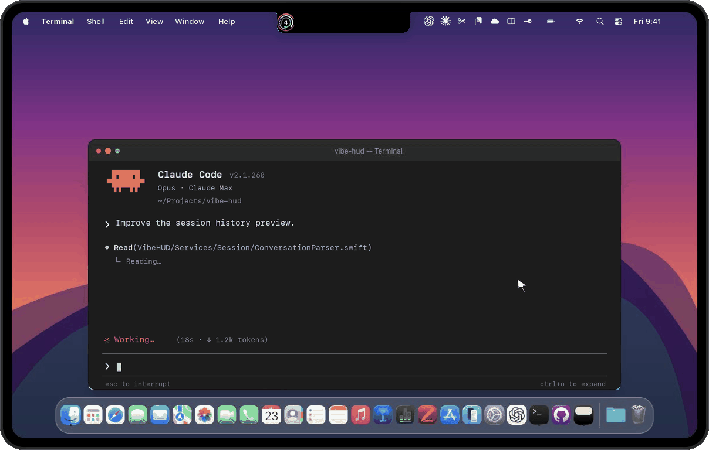

<div align="center">
  
  <h1 align="center">vibe hud</h1>

  <p align="center">
    A macOS notch overlay for Claude Code that keeps your sessions, approvals, replies, and updates within reach.
  </p>

[](https://github.com/section9-lab/VibeHUD/stargazers)
[](LICENSE)
[](https://github.com/section9-lab/VibeHUD/releases/latest)


[](https://ko-fi.com/jackvibe)
[](https://www.patreon.com/jack)

</div>

## Demo

<p align="center">
  
</p>
<p align="center"><sub>Simulated macOS desktop with sample sessions.</sub></p>

## What it does

vibe hud gives Claude Code a fast, ambient control surface on macOS. Instead of bouncing back and forth between your terminal and system prompts, you get a floating HUD for watching sessions, handling approvals, replying to prompts, and checking updates.

## Product highlights

- Live session HUD for multiple Claude Code sessions
- WorkBuddy session status and conversation history through native hooks
- Approve or deny tool requests from the notch
- Answer `AskUserQuestion` prompts without leaving the workflow
- Open chat history and review conversations in-app
- Send replies back to Claude sessions from the HUD
- Works with tmux, Terminal.app, iTerm2, and Ghostty
- Choose your display, sound, Claude directory, and startup behavior
- Check and install signed updates from the notch
- Claude and Codex quota rings, estimated response speed for both, and optional Tibo announcements beside the session HUD

## Main workflows

### Stay on top of active sessions

vibe hud watches your Claude Code activity in real time and keeps the important state visible: running work, waiting input, approvals, and recently active sessions.

### Handle approvals faster

When Claude needs permission to use a tool, vibe hud brings the approval flow to the notch so you can allow or deny it immediately.

### Reply without context switching

When a session needs an answer, you can respond from the HUD instead of manually hunting for the right terminal pane.

### Review conversations in one place

You can open a session view to see history, follow progress, and keep track of what Claude has been doing.

## Requirements

- macOS 15.6+
- Claude Code installed

## Install

Download the latest release from the GitHub releases page and move `VibeHUD.app` into `/Applications`.

Agent hooks are available from the app menu. Release builds refresh hooks that were already enabled when the app starts; other hooks remain off. Local builds leave hooks untouched at launch and allow you to enable them from the menu.

Release downloads:
- https://github.com/section9-lab/VibeHUD/releases/latest

## Settings

From the notch menu, you can configure:

- preferred screen
- notification sound
- Claude config directory
- launch at login
- hooks on or off
- check for updates
- independent quota display switches
- interface language (English or Simplified Chinese)
- Tibo announcement checks and notifications

## Monitoring

Codex quota and text generation speed are read from local Codex session logs by the bundled `codex_usage.py` and `codex_speed.py` workers. The displayed speed estimates visible text tokens per second for eligible responses. No session text is placed in the monitoring cache. The app reads the cache in `~/Library/Application Support/VibeHUD/Monitoring` by default.

Claude speed is estimated locally by `claude_speed.py` from visible output tokens over the interval between an API request (or preceding user event) and the response's last recorded block. That interval can include waiting or thinking time. The worker stores only aggregate counts and rates in the monitoring cache, alongside Claude quota data.

Claude quota uses the bundled `claude_statusline.py` adapter. To enable it, set Claude Code's `statusLine.command` to `python3 "/Applications/vibe hud.app/Contents/Resources/claude_statusline.py"`. The adapter receives Claude Code's status line JSON on stdin and updates the available quota windows in the shared cache. It does not change hooks or collection settings in vibe hud. If Claude Code does not supply quota fields, the rings show an unknown state.

Tibo checks use the public `https://codex-reset.com/api/feed` endpoint when the network setting is on. The six display switches only change what appears in the notch; they do not install hooks or start collectors. Tibo networking has its own switch.

## Compatibility

vibe hud is built around Claude Code on macOS and can route replies through the environments it detects, including:

- bridge mode
- tmux
- Terminal.app
- iTerm2
- Ghostty
- accessibility fallback when needed

Some convenience features depend on your setup. For example, terminal focusing can benefit from tmux and optional window-management tooling.

## Claude directory support

vibe hud works with the current Claude config layout and can resolve the config directory from:

1. `CLAUDE_CONFIG_DIR`
2. the directory you pick in vibe hud
3. `~/.config/claude`
4. `~/.claude`

## Updates

vibe hud uses Sparkle for in-app updates, so installed release builds can check for new versions and install them from the app. Local builds made with `scripts/build-local.sh` disable automatic update checks and Mixpanel initialization; their menu opens the release page.

GitHub tag releases require the `SPARKLE_PRIVATE_KEY` Actions secret matching `SUPublicEDKey` in `VibeHUD/Info.plist`. The workflow signs each DMG and verifies its signature against the built app's public key before publishing. Keep this key pair across releases.

Older builds without an update public key may need a one-time manual reinstall to establish trust in signed updates. Their in-app updater cannot accept a release that changes both the app signing identity and the update signing key.

## Privacy

Monitoring workers keep quota and speed summaries in the current user's Application Support folder. The Codex and Claude speed workers read local session logs without uploading their contents. Tibo checks contact the public feed only when enabled. Release builds retain upstream Mixpanel product analytics for app version, build number, macOS version, and Claude Code version metadata; local builds disable its initialization. Conversation content is not collected by these monitoring workers.

## Build from source

For a release-style local build:

```bash
./scripts/build.sh
```

To package a notarized release DMG:

```bash
./scripts/create-release.sh
```

For a self-contained local build from this repository:

```bash
./scripts/build-local.sh
```

With Xcode installed, the script builds the full asset catalog. With Command Line Tools alone, it builds through SwiftPM and converts the included source icons to PNG resources; verify appearance before distributing that fallback bundle. The script writes `build-local/VibeHUDLocal.app` and never installs or launches it. Set `VIBE_HUD_LOCAL_BUNDLE_ID` to use an existing local app's preferences, and `VIBE_HUD_LOCAL_CACHE_DIR` to read an existing monitoring cache. `VIBE_HUD_REQUIRE_TAKEOVER=1` opts into a separately managed takeover preference for an existing local setup. Preview data requires the explicit `--preview` argument.

The canonical Xcode build is `xcodebuild build -project VibeHUD.xcodeproj -scheme VibeHUD -destination 'platform=macOS' CODE_SIGNING_ALLOWED=NO`. Build artifacts and monitoring caches are excluded from version control.

## Tests

Run the native Swift test suite with Xcode:

```bash
xcodebuild test -project VibeHUD.xcodeproj -scheme VibeHUD -destination 'platform=macOS' CODE_SIGNING_ALLOWED=NO
```

The Python hook adapter, OpenCode JavaScript plugin, and release packaging contract retain focused runtime tests because those components execute outside the Swift process.

Run `bash tests/test_update_signature.sh` to verify acceptance of signed archives and rejection of modified archives, missing or mismatched keys, and incorrect release metadata.

## License

See [LICENSE](LICENSE) and [LICENSE.md](LICENSE.md). The bundled monitoring workers carry their separate MIT notice in `VibeHUD/Resources/usage-workers-LICENSE.txt`.
